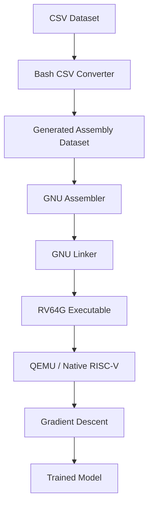

# RISC-V Assembly Linear Regression

Implementation of **Multiple Linear Regression** trained using
**Forward Finite Difference Gradient Descent**, written entirely in
**RISC-V 64-bit Assembly** and targeting Linux-based systems.

This project explores numerical computation and machine learning
fundamentals at the assembly level, without relying on high-level
programming languages or compiler-generated application code.

## Features ##

- **Pure RISC-V Assembly:** Implementation targeting RV64G.
- **Multiple Linear Regression:** Supports multiple numerical features.
- **Forward Finite Difference:** Numerical gradient estimation.
- **Gradient Descent:** Iterative optimization of model parameters.
- **CSV Dataset Conversion:** Bash script that converts CSV datasets
  into RISC-V assembly source code.
- **GNU Toolchain Pipeline:** Assembly and linking without GCC.
- **Build Automation:** Makefile for pipeline automation.
- **Debugging Support:** GDB Multiarch and QEMU integration.

(coming soon)
- **Floating-Point Arithmetic:** Single and double-precision support.

## Architecture ##

The project follows an automated pipeline that converts numerical
datasets into assembly-compatible data and builds the final executable.



## Directory Structure ##

```text
riscv-linear-regression/
├── data/
│   ├── csv-to-riscv-src.sh
│   ├── dataset.s
│   └── example-simple-regression.csv
├── src/
│   └── rv64g/
│       ├── main.s
│       └── main.o
├── LICENSE
├── Makefile
├── README.md
└── linear_regression
```

- `data/`: Contains datasets and the CSV conversion utility.
- `dataset.s`: Generated assembly representation of the dataset.
- `main.s`: Main RISC-V assembly implementation.
- `main.o`: Assembled object file.
- `linear_regression`: Final executable generated by the build pipeline.

Generated files may vary depending on the build configuration.

## Mathematical Background ##

### Multiple Linear Regression ###

The model predicts a target value using a weighted sum of input
features:

$$
\hat{y} = \theta_0 + \sum_{i=1}^{n}\theta_i x_i
$$

Where:

- $\hat{y}$: Predicted value.
- $x_i$: Input features.
- $\theta_i$: Model parameters (weights).
- $\theta_0$: Bias parameter.
- $n$: Number of features.

### Cost Function ###

The model minimizes the Mean Squared Error (MSE):

$$
J(\theta)=\frac{1}{m}\sum_{j=1}^{m}
(\hat{y}_j-y_j)^2
$$

Where $m$ represents the number of training samples.

### Forward Finite Difference ###

The gradient is approximated numerically using forward finite
differences:

$$
\frac{\partial J}{\partial \theta_i}
\approx
\frac{J((\theta_i+\delta)\cup(\theta-\theta_i))-J(\theta)}{\delta}
$$

Where:

- $\delta$: Small numerical perturbation.
- $\theta_i$: Vector element corresponding to parameter $i$.

### Gradient Descent ###

Parameters are updated iteratively using the estimated gradients:

$$
\theta_i \leftarrow \theta_i -
\alpha \frac{\partial J}{\partial \theta_i}
$$

Where $\alpha$ represents the learning rate.

## Dataset Format ##

The input CSV dataset contains numerical feature values and target
labels.

The conversion script transforms the CSV data into RISC-V assembly
memory declarations using `.quad` and `.double` directives.

Example (`example-simple-regression.csv`):

| Feature0 ($x$) | Target ($y$) |
| :---: | :---: |
| 1.0 | 2.0 |
| 2.0 | 3.5 |
| 3.0 | 5.0 |

Your dataset may contain multiple numerical features.

Each row represents one training sample, with the target value
following the input features.

Make sure your CSV format matches the expectations of the conversion
script.

## How to Use ##

This project targets Linux-based RISC-V systems but can be adapted
to other projects and embedded systems supporting the RV64G
instruction set.

### Install Dependencies ###

For Debian, Ubuntu, Linux Mint, and other Debian-based distributions:

```bash
sudo apt update
sudo apt install git make binutils-riscv64-linux-gnu qemu-user gdb-multiarch
```

### Clone this Repository ###

Navigate to your desired directory and clone the repository:

```bash
git clone https://github.com/AlanGomezPasillas/riscv-linear-regression.git
```

### Setup ###

Enter the project directory:

```bash
cd riscv-linear-regression
```

Place your dataset in CSV format inside the `data/` directory.

Make sure the dataset follows the expected format and contains
numerical feature values and target labels.

### Build ###

Execute the following command from the root directory:

```bash
make all
```

This automatically converts your CSV dataset into an assembly source
file, assembles the RISC-V code, links the object files, and generates
the final executable.

### Execution ###

You can execute the program natively on a compatible RISC-V CPU:

```bash
./linear_regression
```

Or using the QEMU user-mode emulator:

```bash
qemu-riscv64 ./linear_regression
```

### Disassembly ###

Inspect the generated machine instructions using:

```bash
make disasm
```

### Debugging ###

Debug the application interactively using:

```bash
make debug
```

The debugging pipeline uses GDB Multiarch and QEMU to inspect
registers, memory, and program execution.

### Cleaning ###

Remove generated build artifacts using:

```bash
make clean
```

## Example Execution ##

A typical execution follows these steps:

1. Load the generated dataset.
2. Initialize the model parameters.
3. Calculate predictions.
4. Estimate gradients using forward finite differences.
5. Update model parameters using gradient descent.
6. Repeat the optimization process until the configured stopping
   condition is reached (default condition uses epochs constant).

The resulting parameters represent the trained linear regression
model.

*Actual execution output and numerical results depend on the dataset
and training configuration.*

## Supported Assembly ISA ##

The initial implementation targets **RV64G**.

The RISC-V G extension profile encompasses:

- **I:** Base integer instruction set.
- **M:** Integer multiplication and division.
- **A:** Atomic instructions.
- **F:** Single-precision floating-point instructions.
- **D:** Double-precision floating-point instructions.

This provides the instruction set required for the current
floating-point implementation.

## Roadmap ##

- [x] RV64G implementation.
- [x] CSV-to-Assembly conversion.
- [ ] Forward Finite Difference.
- [ ] Gradient Descent.
- [ ] Fixed-point Q16 implementation.
- [ ] RISC-V Vector Extension (RVV) support.
- [ ] Performance benchmarks.
- [ ] RISC-V 32-bit compatibility.

## Future Development ##

This project starts with **RV64G**, using its floating-point
capabilities, multiplication, and division instructions.

Future development includes support for fixed-point Q16 arithmetic,
followed by the implementation of the RISC-V Vector Extension (RVV)
to explore vectorized numerical computation.

I also plan to investigate compatibility with smaller RISC-V
architectures and additional instruction set configurations.

## Contributing ##

Contributions, suggestions, and improvements are welcome!

Feel free to open issues and submit pull requests.

If you find a bug or have an idea for a new feature, don't hesitate
to contribute.

## License ##

This project is open source and distributed under the
**GNU General Public License v2.0 (GPL-2.0)**.

See the `LICENSE` file for more information.

## Acknowledgments ##

This project was created as part of my academic work and as an
exploration of machine learning and numerical computation using
RISC-V assembly.

It uses a public-domain example dataset and includes a custom Bash
utility to convert CSV datasets into RISC-V assembly source code.

I hope this project helps others learn about linear regression,
gradient descent, numerical methods, and RISC-V processors.

Feel free to contribute and open pull requests.

If you need to contact me, my email is:

**alangomezpasillas@gmail.com**

I hope you find this project interesting.

I made it with Love. ❤️
